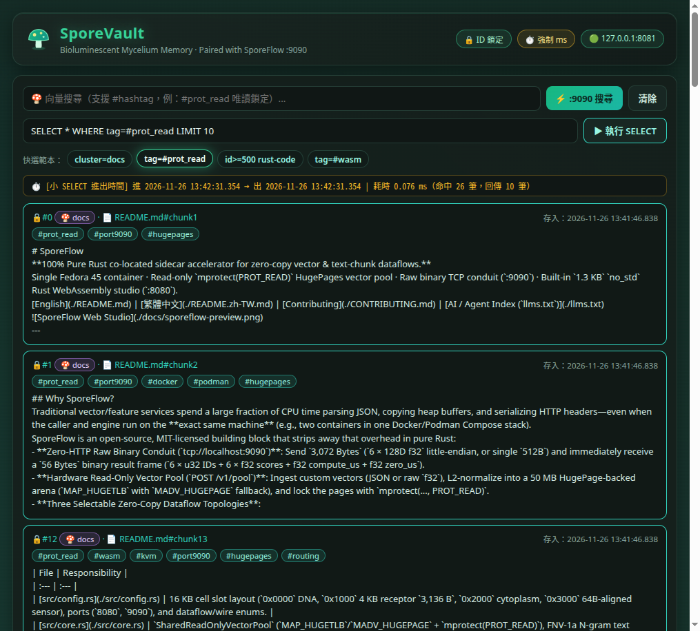

# 🍄 SporeVault

**Zero-dependency Pure Rust persistent mycelium memory store paired with [SporeFlow](https://github.com/exefncs2/sporeflow).**  
Single `~610 KB` binary · Immutable sequential IDs · Mandatory millisecond (`ms`) in/out timestamps · Clusters & `#hashtag` flags · Mini `SELECT` queries · True server-side pagination · Bioluminescent mushroom web UI (`127.0.0.1:8081`).

[English](./README.md) | [繁體中文](./README.zh-TW.md) | [AI / Agent Index (`llms.txt`)](./llms.txt) | [🍄 SporeFlow](https://github.com/exefncs2/sporeflow) | [🛡️ SporeGuard](https://github.com/exefncs2/sporeguard)



---

## Why SporeVault?

[SporeFlow](https://github.com/exefncs2/sporeflow) is a pure in-memory, read-only `mprotect(PROT_READ)` vector sidecar—fast and zero-retention, but it resets on restart and only returns numeric vector IDs.

**SporeVault** is its minimal, zero-dependency companion (`0` external crates in `Cargo.toml`):
- **Immutable Append-Only IDs + Mandatory `ms` Timestamps**: Every record locks its sequential ID (`#0, #1, #2...`) and `created_at_ms` timestamp on write, keeping a permanent 1:1 index mapping with SporeFlow's vector pool.
- **Direct Binary Conduit Speed**: Syncs raw `f32` vectors to `http://127.0.0.1:8080/v1/pool` (`~6 ms` for 714 chunks) and packs queries into all 6 slots of SporeFlow's `tcp://127.0.0.1:9090` Matrix Mesh (`~15–16 ms` end-to-end).
- **Clusters + `#hashtag` Flags + Mini `SELECT`**: Inspired by BigQuery partitioning/clustering—slice your memory by cluster (`rust-code`, `docs`, `config`, `notes`), filter by `#hashtag` flags, or run quick structured queries like `SELECT * WHERE id>=500 cluster=rust-code LIMIT 10`.
- **True Server-Side Pagination (`0.2–0.3 ms`)**: Browse large stores safely (`10 / 20 / 50` per page) without dumping the entire store into the browser.

---

## Honest Scope & Boundaries

- **Best fit**: Ultra-lightweight local knowledge/log/code pre-filter in front of an LLM/Agent (cut 20s full-file prompts down to 2s by grabbing the top chunks in `~16 ms`), or a zero-bloat companion store for SporeFlow.
- **Not a replacement for SQLite3 / Qdrant**: No SQL JOINs, no B-Tree indexes, and currently capped at `7,800` synced vectors per single `/v1/pool` HTTP batch (matching SporeFlow v0.5's 4 MB HTTP buffer).

---

## Quick Start

### 1. Ensure SporeFlow is running locally (`127.0.0.1:8080` & `127.0.0.1:9090`)

```bash
podman run -d --name sporeflow -p 127.0.0.1:8080:8080 -p 127.0.0.1:9090:9090 docker.io/exefncs2/sporeflow:latest --web
```

### 2. Build SporeVault (Zero External Crates)

```bash
# With local Rust
cargo build --release

# Or via Fedora 45 container (no host Rust needed)
podman build -t sporevault:latest -f Containerfile .
```

### 3. Ingest, Query, and Open the Bioluminescent Mushroom UI

```bash
sporevault ingest ./my-notes-or-repo     # Chunk, lock IDs + ms timestamps, sync to SporeFlow
sporevault list                          # View clusters & #hashtag flags
sporevault query "#prot_read 唯讀鎖定"    # Direct :9090 6-slot matrix query
sporevault ui                            # Open http://127.0.0.1:8081/
```

Licensed under the MIT License (`SPDX-License-Identifier: MIT`).
