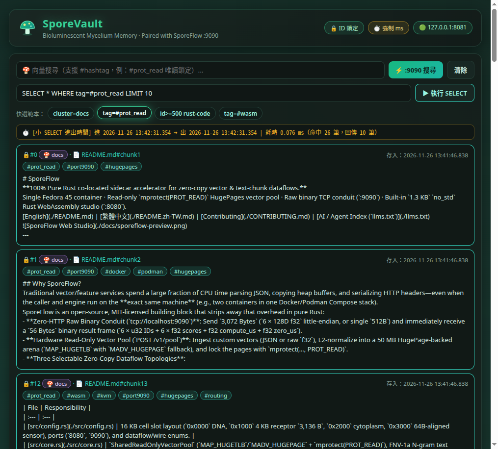

# 🍄 SporeVault（繁體中文說明）

[English](./README.md) | [繁體中文](./README.zh-TW.md) | [AI / Agent 索引 (`llms.txt`)](./llms.txt)



---

## 一、背景與設計定位

[SporeFlow](https://github.com/exefncs2/sporeflow) 是純記憶體唯讀鎖定（`mprotect(PROT_READ)`）的高速算力引擎，但重啟後資料會歸零，且只回傳向量數字 ID。

**SporeVault** 是為它量身打造的**零外部依賴純 Rust 伴生迷你記憶庫**（`Cargo.toml` 依賴數 = `0`，單一執行檔約 `610 KB`），用來補齊落地保存、原文對照與簡易查詢介面：
- **強制順序＋不可變 ID**：每筆紀錄寫入當下即鎖死遞增編號（`#0, #1, #2...`），永遠與 SporeFlow 向量池槽位一對一對齊，絕不錯位。
- **強制時間單位（`ms` 毫秒）**：所有存入紀錄與進出查詢一律強制以 `ms`（UTC+8 台灣時間 `YYYY-MM-DD HH:MM:SS.mmm`）精準記錄。
- **叢集（Clusters）＋ `#hashtag` 插旗 ＋ 小 `SELECT` ＋ 真分頁**：借鏡 BigQuery 分區剪枝概念，不用寫完整複雜 SQL，點一下叢集或 `#hashtag`，或輸入 `SELECT * WHERE id>=500 cluster=rust-code LIMIT 10` 即可在 `0.2~0.3 ms` 內篩出分頁結果。

---

## 二、檔案結構與實際限制

| 檔案 | 職責 |
| :--- | :--- |
| [src/config.rs](./src/config.rs) | 128D 向量常數、`SPVDB003` 單檔二進位格式、`:8080` / `:9090` / `:8081` 埠設定。 |
| [src/core.rs](./src/core.rs) | 單檔原子落盤（`vault.svdb`）、強制 `ms` 時間戳、自動叢集分類、`#hashtag` 抽取（排除 CSS 色碼）、6 槽 `:9090` 直連客戶端。 |
| [src/main.rs](./src/main.rs) | CLI 指令集、小 `SELECT` 解析器，以及僅綁定 `127.0.0.1:8081` 的發光蘑菇主題看內容網頁。 |

- **誠實限制**：不是拿來取代 SQLite3（不支援 JOIN / B-Tree）或百萬級向量庫；單次同步上限為 `7,800` 筆片段（對齊 SporeFlow v0.5 的 4 MB `/v1/pool` HTTP 緩衝區）。最適合當作**個人本機 AI / Agent 前置快篩庫**。

---

## 三、安裝與使用方式

```bash
# 1. 確保本機 SporeFlow 已在 127.0.0.1:8080 與 :9090 運行
podman run -d --name sporeflow -p 127.0.0.1:8080:8080 -p 127.0.0.1:9090:9090 docker.io/exefncs2/sporeflow:latest --web

# 2. 編譯 SporeVault（零外部依賴）
cargo build --release

# 3. 匯入檔案、查詢與開啟發光蘑菇介面
sporevault ingest ./my-project
sporevault query "#prot_read 唯讀鎖定"
sporevault ui   # 打開 http://127.0.0.1:8081/
```

授權條款：MIT（`SPDX-License-Identifier: MIT`）。
